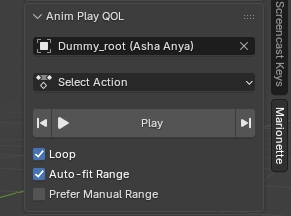

# Anim Play QOL

   A small addon for Blender that takes the routine out of previewing animations.

   The timeline automatically fits to the length of the currently playing action — on any object, from any context. Switch actions in the Action Editor or Dope Sheet, load a new action from a script, trigger NLA playback, or assign an action through another addon — the frame range follows instantly. No more scrolling the max frame just to see the loop.

   All settings are gathered in a convenient panel in the N-panel (Sidebar) under the **Marionette** category.

   

## Features:
   - **Auto-fit Range** — Automatically sets `frame_start` and `frame_end` to match the bounds of the currently playing action. Works with any object in the scene, not just the one selected in the addon panel — the panel selection is only a shortcut for quickly browsing and assigning actions.
   - **Smart Loop** — Checkbox on: animation loops. Checkbox off: animation plays to the end, timeline resets to the start, and playback stops.
   - **Prefer Manual Range** — If enabled in the Action Editor, the addon will use the manual frame range set for the action instead of the real keyframe bounds.
   - **Play/Pause Button** — Playback button right in the panel, so you don't have to reach for the spacebar.
   - **Action Info** — Shows the current active action, its frame range, and whether Manual Range is being used.
   > ⚠️ **Limitation:** Multiple objects playing actions of different lengths at the same time is not supported/tested. The timeline fits to a single action.

## Installation
   1. Go to the **Releases** section on the right side of this GitHub repository page.
   2. Download the ZIP archive.
   3. Blender 4.2+: `Edit` -> `Preferences` -> `Add-ons` -> `Install from Disk...` -> select the ZIP.  
      Or simply drag the archive into the Blender window.
   4. Enjoy.